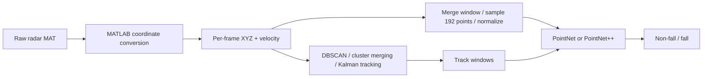
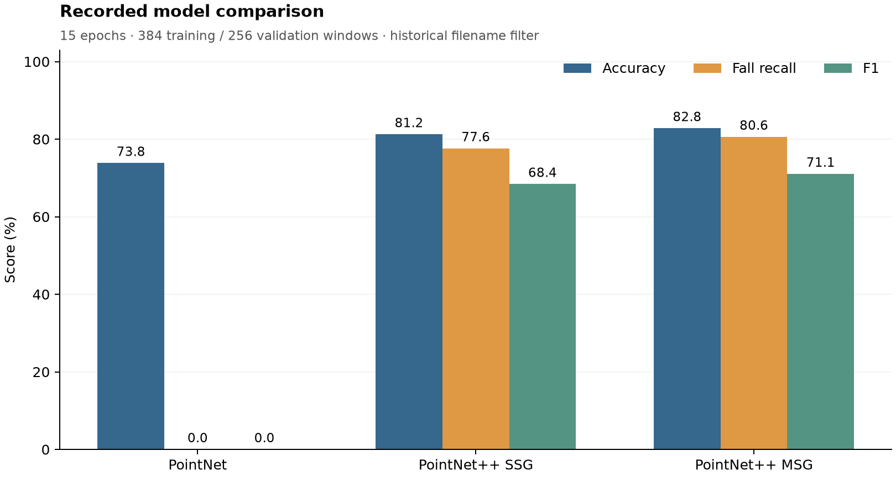

# Indoor Fall Detection Based on Millimeter-Wave Radar

A final year project on fall detection using ceiling-mounted radar point clouds. The project covers radar data parsing, PointNet / PointNet++ classification, and an experimental multi-person tracking pipeline.

The classifier merges points from a short window and predicts **non-fall (0)** or **fall (1)**. The tracking branch separates scene points into track segments before classification. It is an offline research pipeline.

## Pipeline



Only XYZ coordinates enter the classifier. Velocity is retained in the processed files. Window points are merged as an unordered set; the model does not explicitly encode frame order.

## Structure

```text
matlab/                  Radar parsing and coordinate conversion
models/                  PointNet, PointNet++ SSG and MSG
data_utils/             Frame-window loader and filename filtering
train_classification.py  Frame-window training
evaluate.py              Held-out evaluation of the reference classifier
predict.py               Predict one merged window from a NumPy array
debug_tools/             Track reconstruction and track-window training
scene_level_tools/       Whole-scene multi-person baseline
target_inference_tools/  Apply the classifier to multi-person tracks
model_comparison_tools/  Small-subset model comparison
weights/                 Two exported reference checkpoints
metrics/                 Recorded results and model provenance
examples/                Synthetic lifestyle illustration
tests/                   Pipeline regression checks
docs/                    Data notes, file map and verification
```

## Setup

Use Python 3.10 or later. Python 3.12 was used for verification.

```bash
python -m venv .venv
source .venv/bin/activate
python -m pip install -r requirements.txt
python -m unittest discover -s tests -v
```

The recorded result figure can be regenerated with `requirements-plots.txt` and `python model_comparison_tools/plot_recorded_results.py`. See [verification](docs/verification.md) for the tested environment and checks.

Run the commands below from the repository root. PyTorch uses CUDA when available; add `--use_cpu` for CPU execution. No RealSense camera or serial connection is needed for these entry points.

## Data preparation

Raw recordings and videos are kept outside this repository. You need your own local radar files to train or evaluate the model.

The MATLAB parser expects the original `frame_data` structure, using the type-3 protocol:

```matlab
addpath('matlab');
prepare_frames('/path/to/raw_mat', '/path/to/processed_data', 2.1, false, false);
```

Arguments after the folders are radar height, frame visualization and overwrite permission. The original parser used **2.1 m**, while the acquisition note states **2.7 m**. Set the height from the actual sensor calibration. The example preserves the original parser setting.

Each MATLAB v7.3 `*_frames.mat` file contains:

- `points_per_frame{t}`: an `N × 5` matrix of `[x, y, z, vx, vy]`. HDF5 readers usually see it transposed.
- `flags_per_frame{t}`: a scene flag such as `1-0`, `2-1` or `3-1`.
- `segments`: consecutive ranges with the same flag.

| Flag | Binary label |
| --- | --- |
| `1-0`, `2-0`, `3-0` | 0 — non-fall |
| `1-1`, `2-1`, `3-1` | 1 — fall |

The frame loader skips unknown flags, including the slash-form flags `1/0` and `1/1` found in three local recordings. Existing processed files also contain legacy `[100, 100, 100]` empty-frame sentinels. Their treatment is preserved for checkpoint compatibility; see [data notes](docs/data_notes.md) before building a new dataset.

The local `PointNet/processed_data` cache and the parser's `processed_data` folder contain different sets of files. Do not mix them when comparing historical results.

## Train and evaluate

Train the PointNet++ SSG classifier on single-person recordings:

```bash
python train_classification.py \
  --data_root /path/to/processed_data \
  --model pointnet2_cls_ssg --data_mode single \
  --num_point 192 --window_size 15 --stride 5 \
  --epoch 20 --batch_size 16 --log_dir radar_ssg --seed 42
```

The loader splits sorted files before creating windows: the first 80% are used for training and the rest for validation. This is a file-disjoint split, not a subject-independent split. Windows are drawn within constant-label segments, so these validation metrics describe offline window classification.

New training excludes filenames containing `双人` or `三人` from the single-person set. Historical code only searched for `一人`, which also selected two recordings described as “three people, one person falls”. `--legacy_name_filter` reproduces that old selection when needed. The included reference checkpoint records this historical setting in its metadata.

Training writes checkpoints, metric CSV files and SVG curves under `log/classification/<log_dir>/`. Class-weighted loss and balanced sampling are enabled in this entry point. Use `--no-balanced_sampling` to disable the sampler.

```bash
# Continue an existing run, including its optimizer state.
python train_classification.py \
  --data_root /path/to/processed_data --log_dir radar_ssg --resume --epoch 40

# Evaluate the included reference checkpoint with its stored preprocessing.
python evaluate.py --data_root /path/to/processed_data --use_cpu
```

`evaluate.py` saves a confusion matrix and sample-counted metrics to `outputs/evaluation.json`. FPS sampling is random; `--seed` controls the random state for a run.

For one window, save its merged, unnormalized XYZ points as an `N × 3` NumPy array:

```bash
python predict.py --points /path/to/window.npy --use_cpu
```

This command samples and normalizes the points before inference. The output contains two softmax scores; they have not been calibrated as event probabilities.

## Multi-person experiments

Rebuild tracks from processed frames:

```bash
python debug_tools/rebuild_all_tracks.py \
  --input /path/to/processed_data \
  --output debug_tools/rebuilt_tracks --save-every 0
```

The tracker uses DBSCAN on the y-z plane, cluster merging, a constant-velocity Kalman filter and gated assignment. Tracks are split at large jumps or long observation gaps. Output includes `rebuilt_tracks.npz`, track summaries and SVG paths. Track IDs identify segments and should not be interpreted as the number of people in a recording.

Train a track-window model:

```bash
python debug_tools/train_multiperson_classification.py \
  --rebuilt_root debug_tools/rebuilt_tracks \
  --model pointnet2_cls_ssg --window_size 15 --stride 5 \
  --weighted_sampler --sampler_power 0.5 --epoch 20 --log_dir multi_ssg
```

Track training uses a 75% / 25% sorted-case split and retains pure-label windows from tracks without a fall-to-non-fall transition. A track window spans observations, which may include missed frames. Load only track NPZ files generated locally by this pipeline, since their object arrays require pickle loading.

Apply the reference classifier to multi-person tracks:

```bash
python target_inference_tools/run_single_model_on_multiperson.py \
  --input /path/to/processed_data \
  --checkpoint weights/fall_ssg_reference.pth \
  --output outputs/track_inference --window_size 15 --stride 5 --use_cpu
```

This branch inherits the **scene flag** for each track. There are no independent per-person fall annotations, and no validated tracking identity metrics. Applying the reference classifier to separated tracks is an experimental transfer. The default track decision checks whether any window's fall score reaches 0.5; the threshold is not calibrated.

The whole-scene baseline is available separately:

```bash
python scene_level_tools/train_scene_classification.py \
  --data_root /path/to/processed_data --epoch 20 --log_dir scene_ssg
```

## Recorded results

### Small model comparison

These results come from the existing 15-epoch experiment: 384 training windows and 256 validation windows, with 189 non-fall and 67 fall validation samples. All three models used 192 points and 15-frame windows with stride 5. This experiment used the historical filename filter described above.

| Model | Best epoch | Accuracy | Precision | Fall recall | F1 |
| --- | ---: | ---: | ---: | ---: | ---: |
| PointNet | 10 | 73.83% | 0.00% | 0.00% | 0.0000 |
| PointNet++ SSG | 6 | 81.25% | 61.18% | 77.61% | 0.6842 |
| PointNet++ MSG | 13 | 82.81% | 63.53% | 80.60% | 0.7105 |

PointNet predicted the majority non-fall class for every validation window at its selected epoch. Accuracy alone does not describe fall detection performance.



The full recorded history is in [small_model_comparison_results.json](metrics/small_model_comparison_results.json). The comparison script did not save model checkpoints. The weights below come from separate runs.

```bash
# Repeat the historical experiment setup; exact training values can vary.
python model_comparison_tools/run_small_model_comparison.py \
  --data_root /path/to/processed_data --legacy_name_filter \
  --epochs 15 --max_train 384 --max_val 256 --seed 42
```

### Included checkpoints

| File | Source | Status |
| --- | --- | --- |
| `weights/fall_ssg_reference.pth` | `report_small_pipeline`, epoch 3 | Binary SSG reference; historical filename filter |
| `weights/multi_person_ssg_smoke.pth` | `best_soft_sampler_e6`, epoch 2 | Small experimental track run with scene-derived labels |

The first checkpoint was re-evaluated on the local held-out 328 windows: **72.56% accuracy, 42.07% precision, 91.04% fall recall and 0.5755 F1**. Its confusion matrix is `[[177, 84], [6, 61]]`, with true labels on rows. This matches the saved epoch-3 record. See [reference evaluation](metrics/reference_evaluation.json).

The exported model tensors are unchanged. Optimizer state and machine-specific arguments were removed from the two reference files. Source paths, hashes and preprocessing settings are recorded in [model_sources.json](metrics/model_sources.json).

Other local checkpoints include unrelated three-class and four-class experiments. They are excluded. Projected 2,000-epoch curves and the hand-set 92.3% confusion matrix are also excluded from measured results. See [result provenance](docs/results_provenance.md).

## Optional illustration

```bash
python examples/lifestyle_demo.py
```

This generates a **synthetic** lifestyle and trajectory illustration from hand-defined values. It is separate from radar training and evaluation, and is not a measured daily-life study.

## Credits

The PointNet / PointNet++ model code, augmentation utilities and parts of the training structure are based on [yanx27/Pointnet_Pointnet2_pytorch](https://github.com/yanx27/Pointnet_Pointnet2_pytorch). The original MIT notice is retained in [LICENSE](LICENSE). See [THIRD_PARTY_NOTICES.md](THIRD_PARTY_NOTICES.md) for scope and attribution.
